# Publicar um site interativo no GitHub Pages

Vamos utilizar o GitHub para publicarmos o nosso site.
Para isso vamos precisar:

1. Criar uma conta no GitHub
1. Criar o nosso site
1. Publicar o nosso site
1. Ativar o GitHub Pages

## Criar conta no GitHub

> [!NOTE]
> Se você já tem conta no GitHub, pode pular esta etapa.

Visite o site do GitHub em [https://github.com/](https://github.com/).
Entre com o seu e-mail de clique em `Sign up for GitHub`.


Entre com os seus dados pessoais e siga os passos para terminar de criar a conta.

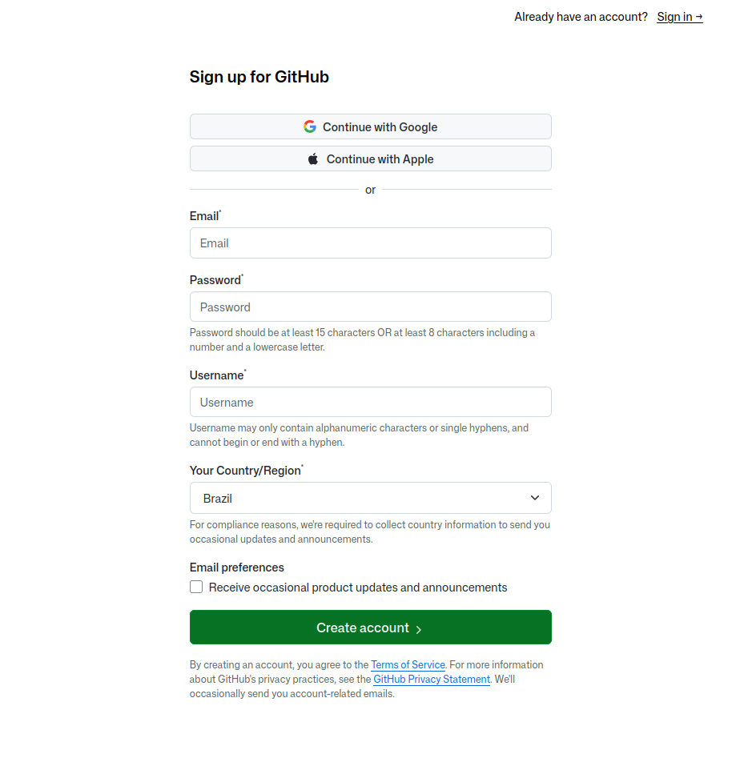

## Criar o nosso site

Vamos criar uma aplicação simples usando somente HTML, CSS e JavaScript, publicá-la no GitHub Pages e permitir que qualquer pessoa acesse a aplicação pelo navegador, sem instalar nada.

O exemplo será uma pequena aplicação interativa que simula uma calculadora. 
Depois, você poderá substituir esse exemplo pelo código da sua própria aplicação.

O GitHub Pages publica arquivos estáticos e pode servir HTML, CSS e JavaScript diretamente. 
Para este caso, não precisamos de Django, Node.js, Jekyll ou de um processo de compilação.

## Criar o repositório no GitHub

> [!NOTE]
> Neste exemplo, vou assumir que o nome de usuário do GitHub é `alexandre-att`. 
> Substitua esse texto pelo nome real da sua conta nos comandos e endereços a seguir.

Vamos criar um repositório para armazenar as páginas do nosso site.
Opcionalmente você pode usar um repositório seu já existente.

Na página inicial do GitHub (`Dashboard`), (1) clique no notão com o símbolo de `+` localizado no canto superior direito da tela e depois (2) selecione `New repository`:

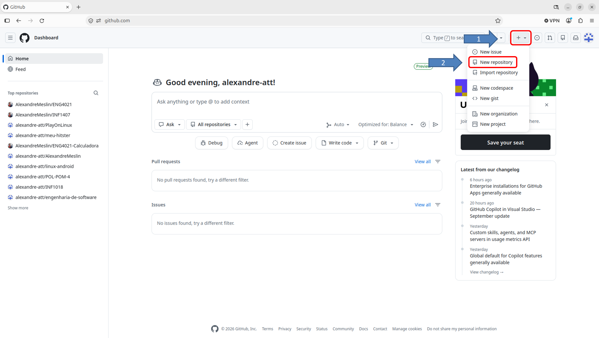

Na página `Create a new repository` (`Criar um novo repositório`), preencha os campos do formulário de acordo com a sua necessidade.
A seguir, uma sugestão:

\# | Field | Campo | Valor
---|---|---|---
1 | Repository name* | Nome do repositório* | Minhas Páginas
2 | Description | Descrição | Exemplo de uso do GitHub Pages
3 | Choose visibility * | Selecione a visibilidade | Public
4 | Add README | Adicionar README | On

Clique em (5) `Create repository` (`Criar repositório`)

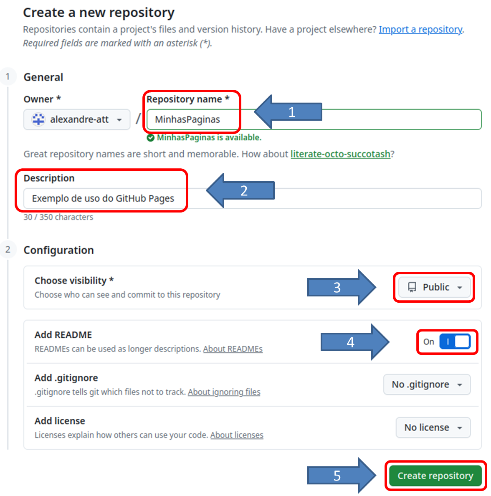

> [!WARNING]
> O site publicado é acessível pela Internet; não coloque senhas, tokens, chaves privadas ou outros dados sigilosos nos arquivos.

## Criar a estrutura de diretórios

No seu laptop, crie uma pasta para o projeto com esta estrutura:

```txt
site
├── calculadora
├── css
│   └── estilos.css
├── js
│   └── script.js
└── index.html
```

O arquivo index.html deve ficar na raiz da pasta que será publicada. 
O GitHub Pages procura esse arquivo para apresentar a página inicial do site. 

## Criar o arquivo index.html

Crie o arquivo `index.html` com o seguinte conteúdo:

```html
<!DOCTYPE html>
<html lang="pt-BR">
<head>
    <meta charset="UTF-8">
    <meta name="viewport" content="width=device-width, initial-scale=1.0">
    <link rel="stylesheet" href="css/estilos.css">
    <script src="js/script.js"></script>
    <title>Meu Site</title>
</head>
<body>
    <main>
        <h1>Bem-vindo ao Meu Site</h1>
        <p>Este é o conteúdo principal do meu site.</p>
        <nav>
            <ul>
                <li><a href="#">Início</a></li>
                <li><a href="calculadora">Calculadora</a></li>
                <li><a href="#">Sobre</a></li>
                <li><a href="#">Contato</a></li>
            </ul>
        </nav>
    </main>
</body>
</html>
```

## Implementar o CSS

Crie o diretório `css` e, dentro dele, o arquivo `estilos.css`:

```css
* {
    box-sizing: border-box;
}

body {
    margin: 0;
    padding: 32px 16px;
    font-family: Arial, sans-serif;
    background: #f2f4f8;
    color: #202938;
}

.container {
    max-width: 600px;
    margin: 0 auto;
    padding: 24px;
    background: white;
    border-radius: 12px;
    box-shadow: 0 4px 16px rgba(0, 0, 0, 0.08);
}

h1 {
    margin-top: 0;
}

form {
    display: flex;
    flex-wrap: wrap;
    gap: 10px;
    align-items: center;
}

label {
    width: 100%;
}

input {
    flex: 1;
    min-width: 150px;
    padding: 10px;
    border: 1px solid #aab2bf;
    border-radius: 6px;
}

button {
    padding: 10px 16px;
    border: 0;
    border-radius: 6px;
    background: #175cd3;
    color: white;
    cursor: pointer;
}

button:hover {
    background: #1249a8;
}

li {
    margin-top: 12px;
}

.remover {
    margin-left: 12px;
    padding: 5px 9px;
    background: #b42318;
}

#mensagem {
    min-height: 1.5em;
    color: #176b36;
}
```

## Implementar o JavaScript

Crie o diretório `js` e, dentro dele, o arquivo `script.js`.
Por enquanto, este arquivo vai ficar vazio - pode ser que no futuro,
você pense em alguma coisa para colocar nele.

## Enviar os arquivos para o GitHub

Há três formas de fazer isso: 

1. criar os arquivos diretamente pela interface do GitHub,
1. trabalhar localmente e enviar com Git ou
1. enviar os arquivos pela interface web do GitHub

A segunda opção facilita a manutenção da aplicação.

A terceira opção, que nós usaremos, é a mais simples (NÂO é a melhor, use a segunda opção depois que você aprender a usar GIT!).

### Subindo os arquivos pela primeira vez

Na raiz do repositório, clique no botão `Add file` e selecione `Upload files`:

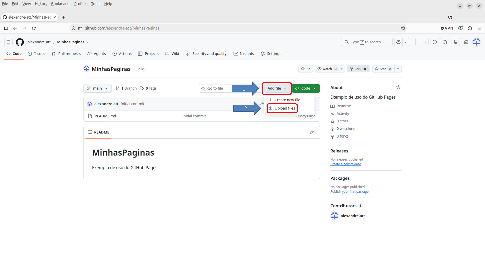

> [!WARNING]
> Leia com atenção! Não é para arrastar a pasta `site`, apenas o seu conteúdo!

1. Arraste o conteúdo da pasta `site` para a área descrita como `Drag files here to add them to your repository`.

> [!IMPORTANT]
> Veja na figura o caminho correto que deve ser mostrado na página de *upload*.

2. Certifique-se de que os arquivos `estilo.css`, `index.html` e `script.js` estejam na área de *upload*.

> [!NOTE]
> Note que a pasta `calculadora` não aparece na área de upload porque ela está vazia.
> O GitHub não faz upload de pastas vazias.

3. Coloque um texto descrevendo o motivo deste *upload* na caixa `Commit changes`, no campo descrito como `Add files via upload`.

4. Opcionalmente coloque um comentário na caixa de comentários.

5. Clique no botão verde `Commit changes`.

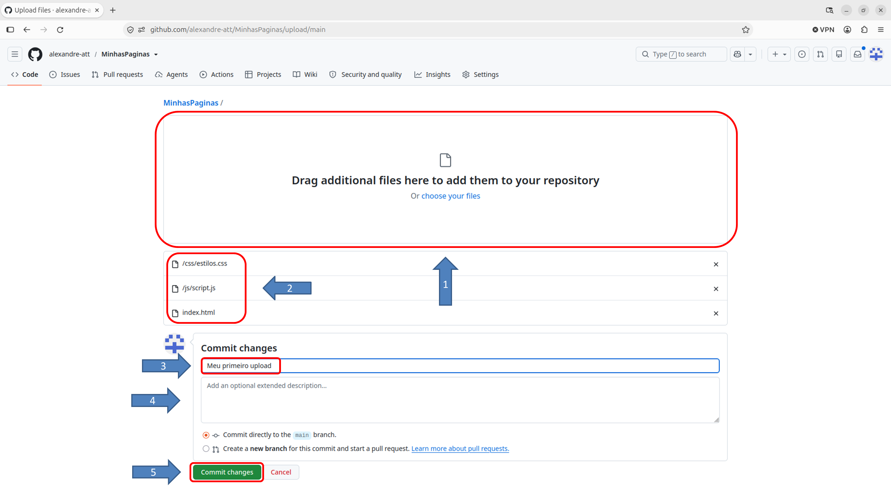

## Ativar o GitHub Pages

Esta é a etapa que torna a aplicação acessível pela Internet.

1. Abrir as configurações

    Entre no repositório aplicacao-interativa e clique em `Settings`:

    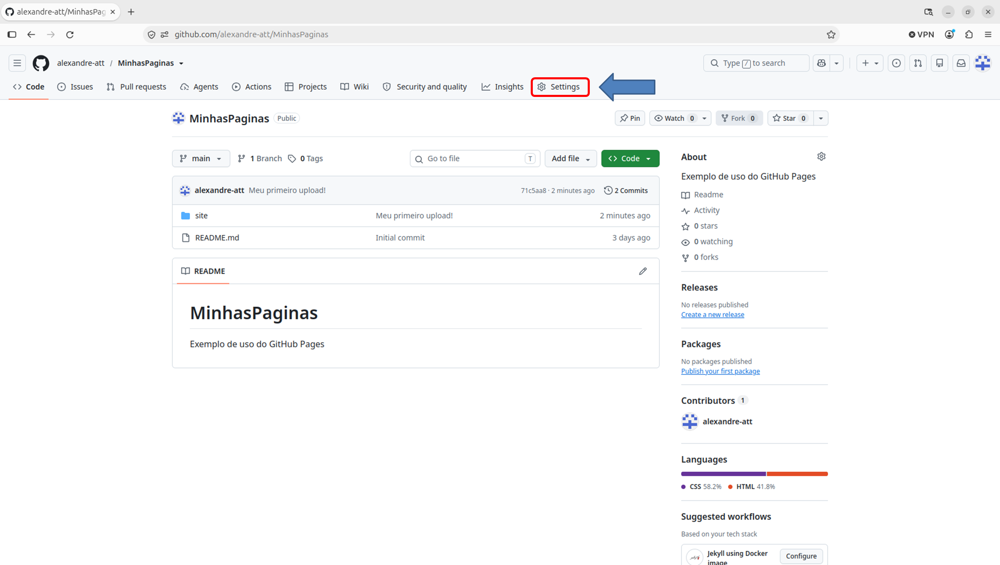

1. Selecionar Pages

    No menu lateral, procure a seção `Code, planning, and automation` e clique em `Pages`:

    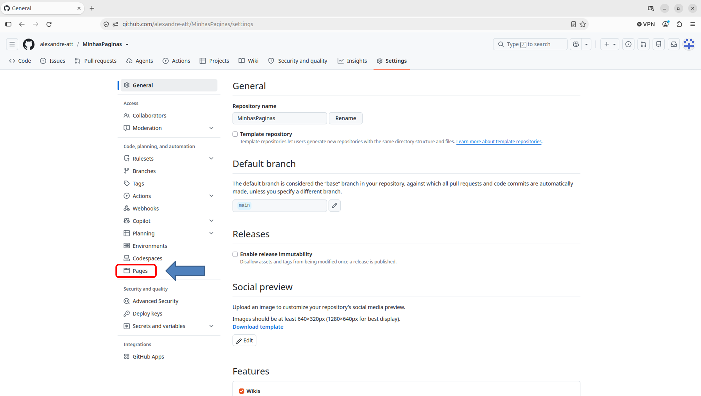

1. Escolher a origem da publicação

    Em `Build and deployment`, configure:

 - `Source`: `Deploy from a branch`
 - `Branch`: `main`
 - `Folder`: `/(root)`

    Depois, clique em `Save`:

    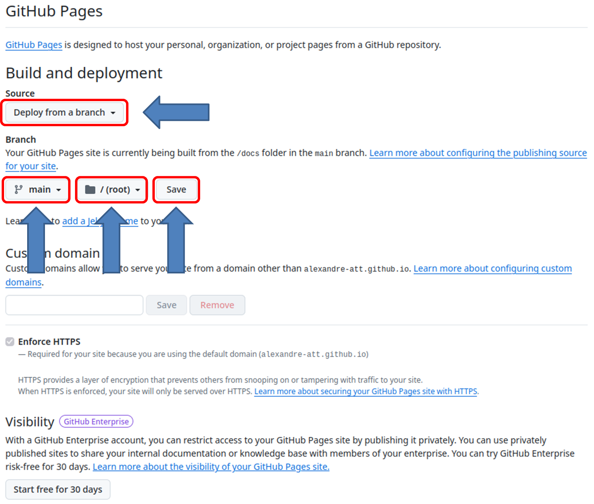

    Essa configuração informa ao GitHub que os arquivos publicados estão na raiz da branch main.

Certifique-se que o site foi publicado com sucesso.
Veja a figura a seguir:

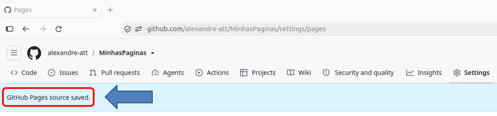

## Acessar a aplicação publicada

Após salvar a configuração, abra novamente `Settings` -> `Pages`.
Aguarde a conclusão da publicação.
Se não houver a confirmação, repita esse processo algumas vezes.
A publicação pode demorar até 10 minutos.

Quando aparecer, anote o endereço do seu site.
Para visitar o site, clique em `Visit site` ou coloque o endereço em um navegador.

> 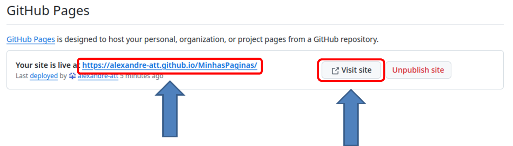

Para um repositório de projeto, o endereço será:

https://SEU-USUARIO.github.io/MinhasPaginas/

Por exemplo, se o nome da conta fosse exemplo123, o endereço seria https://exemplo123.github.io/MinhasPaginas/.

## Atualizar a aplicação

Vamos agora começar a criar a sua calculadora.
Na pasta `calculadora`, crie a pasta `js`.
Na pasta `js`, crie o arquivo `calculadora.js`.

```txt
site
├── calculadora
│   └── js
│       └── calculadora.js
├── css
│   └── estilos.css
├── index.html
└── js
    └── script.js
```

Na raiz do seu repositório, clique novamente em `Add file` e depois selecine `Upload files`.
Arraste a pasta `calculadora` para a área descrita como `Drag files here to add them to your repository`.
Coloque uma descrição para o seu *upload*, como, por exemplo, `Arquivo de script ainda vazio da calculadora`.
Clique no botão verde `Commit changes`.

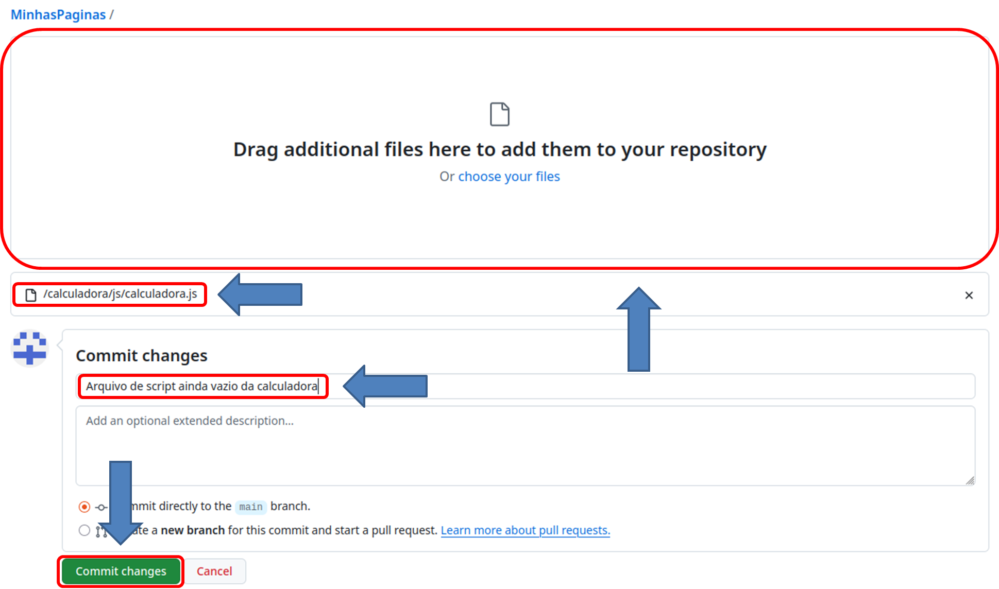

Novamente pasta `calculadora`, crie o arquivo `index.html` e as pastas `css` e `img`.
Na pasta `css` crie o arquivo `calculadora.css`.

```txt
site
├── calculadora
│   ├── css
│   │   └── calculadora.css
│   ├── img
│   ├── index.html
│   └── js
│       └── calculadora.js
├── css
│   └── estilos.css
├── index.html
└── js
    └── script.js
```

Agora faça o upload do arquivo `index.html` e da pasta `css`.

Este é o processo que você deve fazer sempre que atualizar algum arquivo.

## Próximos Passos

1. Use o repositório para implementar o seu jogo Whac-A-Mole

1. Crie links para outros sites e outras páginas na sua home-page

1. Coloque o(s) link(s) no Linked-in!

# Deixando de ser Pikachu (ou seja, evoluindo!)

Existem melhores maneiras de trabalhar com o Git, principalmente com o GitHub.
Mas, agora, estude para evoluir!

1. Clone o repositório remoto para a sua máquina local e use o VS-Code para editar e gerenciar a atualização do repositório remoto.

1. Use o Codespace para editar os arquivo e visualizar os resultados, e para gerenciar o repositório remoto.

## Problemas conhecidos e suas "soluções"

Consulte esta tabela para diagnosticar os problemas mais comuns.

---

### Problema

Página com erro 404

### Solução 

Verificar se o arquivo `index.html` está na raiz publicada e se a configuração usa `main` e `/(root)`.

---

### Problema

Página aparece sem estilos

### Solução

Verificar se o caminho `css/estilos.css` está correto, inclusive maiúsculas e minúsculas.

---

### Problema

Alterações não aparecem

### Solução

Confira o último *commit*, o *status* em `Actions` e tente recarregar a página sem usar o *cache* (Ctrl+Shift+R).

---

### Problema

Site ainda não foi publicado

### Solução

Aguarde alguns minutos e verifique se a execução de publicação terminou com sucesso.
